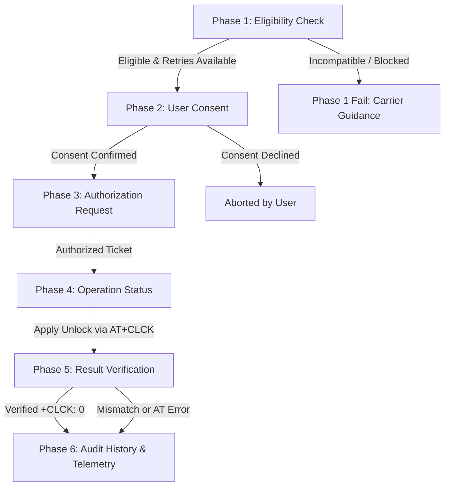

# SIM-Unlock Integration & Legitimate Service Specification

## 1. Scope & Objective
This specification defines the architecture, eligibility evaluation, server authorization boundaries, and hardware execution model for legitimate, carrier- and manufacturer-authorized SIM Network Personalization (SIM-lock) unlocking within the **Nexus Device Service** platform.

This implementation complies strictly with:
- **3GPP TS 27.007**: AT command set for User Equipment (UE), specifically Section 7.4 (`AT+CLCK` Facility Lock).
- **3GPP TS 22.022**: Personalisation of Mobile Equipment (ME).
- **ITU-T / GSMA Carrier Unlock Guidelines**: Ethical, authorized unlocking mechanisms based on carrier customer agreement validation and clean IMEI verification.

---

## 2. Supported Device Families & Restrictions

### 2.1 Supported Reference Hardware
- **Quectel EC25 / EG25 Series (Qualcomm MDM9607 baseband)**:
  - Documented 3GPP Facility: `"PN"` (Network Personalization / SIM lock).
  - Query Command: `AT+CLCK="PN",2`
  - Unlock Command: `AT+CLCK="PN",0,"<NCK>"`
  - Status Query: `+CLCK: <status>` where `0 = Unlocked`, `1 = Locked`.

### 2.2 Regional and Carrier Restrictions
- Devices locked to specific carrier networks (MCC/MNC) require a carrier-generated **Network Control Key (NCK)**.
- Unlocking attempts are bounded by a hardware security counter (standard: 3 to 10 attempts).
- Once the counter is exhausted, the baseband enters `PermanentlyBlocked` state (PUK/MEP blocked). Software commands cannot and must not attempt to force or reset this counter.

### 2.3 Strict Security & Ethical Guardrails
1. **No Secret Keys in Desktop Binary**:
   - Provider credentials, master carrier private keys, and authorization client secrets are **never** stored in or bundled with the client application.
   - All authorization requests must be signed by an authorized remote carrier server.
2. **No Exploits or Counter Manipulation**:
   - The platform strictly forbids NVRAM fuzzing, bootloader exploit chains, brute-forcing NCK codes, or bypasses.
3. **Honest Unsupported Reporting**:
   - If a device is unsupported, foreign-locked without an authorization API, or permanently blocked, the platform reports `Unsupported` or `PermanentlyBlocked` with official carrier service guidance.
4. **Mock vs Real Separation**:
   - Development and CI/CD test suites utilize a mock authorization authority. Mock results are explicitly flagged with `IsMockAuthorization = true` and `IsMockSuccess = true`.

---

## 3. The Six Architectural Phases

To guarantee auditability, legal compliance, and hardware safety, the SIM unlock workflow is strictly divided into six decoupled phases:

### Phase 1: Eligibility Checks
- Inspects device descriptor (model family compatibility).
- Establishes communication over `IModemCommunicationChannel`.
- Queries network personalization status (`AT+CLCK="PN",2`).
- Checks remaining attempt counter.
- If status is `0 (Unlocked)`, returns `AlreadyUnlocked`.
- If status is permanently locked or retries exhausted, returns `PermanentlyBlocked` with official referral.
- If hardware family is unrecognized, returns `Unsupported` with carrier referral.

### Phase 2: User Consent
- Displays terms and condition requirements (device ownership verification, carrier agreement fulfillment).
- Captures explicit timestamped consent object (`SimUnlockConsent`) acknowledging that once applied, the NCK attempt is decremented if invalid.

### Phase 3: Authorization Request
- Submits device metadata (hashed/masked IMEI, model, carrier) to the authorized carrier API client.
- When running in development/offline test mode, uses `MockSimUnlockAuthorizationClient`, generating a cryptographically simulated ticket explicitly marked `IsMockAuthorization: true`.
- Tokens have strict expiration windows (TTL).

### Phase 4: Operation Status
- Reports fine-grained progress across execution stages via `IOperationProgressReporter`:
  - 10%: Pre-flight channel acquisition.
  - 30%: Sending authorized NCK payload via secure facility lock command.
  - 70%: Waiting for baseband acknowledgment.
  - 90%: Querying physical lock status post-unlock.
  - 100%: Completed.

### Phase 5: Result Verification
- Does not rely solely on the `OK` response of the unlock command.
- Automatically executes a follow-up query: `AT+CLCK="PN",2`.
- Confirms `+CLCK: 0`. If `+CLCK: 1` persists, marks operation as failed with detailed error analysis (`+CME ERROR: 16` incorrect password).

### Phase 6: Audit History
- Generates an immutable `SimUnlockAuditRecord`:
  - Device ID and Masked IMEI (`[REDACTED_IMEI_****4567]`).
  - Ticket ID and Carrier ID.
  - Operation result (Success / Failure).
  - Explicit flag `IsMockSuccess`.
  - Timestamp.
- Persists record to the local audit store for diagnostic and legal traceability.
